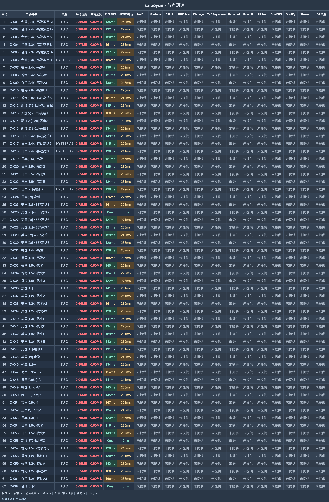

# 赛博云测速与节点怎么选？倍率、场景及三家横向比较（2026-11-18）

> **先看测速结论：**2026-10-17 的历史样本包含 62 个节点，其中 59 个连通；延迟中位 134ms、速度中位 6.3 MB/s，最快平均速度 9.3 MB/s。高均速样本横跨新加坡、香港、美国、德国和荷兰，不能把“距离近”直接等同于“本地一定更快”。
>
> 👉 **[先用 3 元月付验证自己的常用线路](https://saiboyun.org/#/register?code=dAvrmHqg)** · 轻量套餐含 120G、5 台设备、60M 限速；先试节点，再决定是否升档。

## 赛博云适合哪些使用场景

**更适合：**

- 想以较低成本测试机场线路，首月预算只准备 3 元。
- 需要香港、日本、新加坡、美国等多个地区，不只盯一个落地。
- 用量时高时低，希望周期套餐之外还有不清零的按量包。
- 愿意看节点名里的倍率，不会把 2.4x、2.5x 高端节点当作 1x 扣量。

**不太适合：**

- 要求所有节点始终连通；这轮历史记录是 59/62，不是 62/62。
- 只接受低倍率，却又想长期使用高端节点。
- 入门就需要高带宽、多设备和 IEPL；3 元档只应承担试用任务。

| 首屏判断 | 已核信息 |
|---|---|
| 历史测试时间 | 2026-10-17 18:26–18:39 |
| 测试环境 | 中国大陆家宽出口香港；每节点连测 3 次取最优 |
| 节点 / 连通 | 62 / 59 |
| 延迟中位 | 134 ms |
| 速度中位 | 6.3 MB/s |
| 最快平均速度 | 9.3 MB/s |
| 节点倍率 | 0.9x–2.8x |
| 入门套餐 | 3 元/月、120G、5 台、60M |
| 协议 | TUIC / Hysteria2 / anyTLS |

## 怎么读这份赛博云测速

这份结果适合回答三个问题：**该轮有多少节点能连、各节点的延迟落在哪个区间、同一环境下哪些节点更值得先试。**它不是长期可用率，也不能代替你所在城市、运营商和晚高峰的复测。

历史样本里，均速靠前的节点如下：

| 节点 | 倍率 | 延迟 | 完整请求 | 平均速度 | 最高速度 |
|---|---:|---:|---:|---:|---:|
| 新加坡高端1 | 2.5x | 159ms | 237ms | **9.30 MB/s** | 11.14 MB/s |
| 新加坡高端2 | 2.5x | 120ms | 282ms | **9.09 MB/s** | 11.06 MB/s |
| 香港高端A1 | 2.4x | 141ms | 245ms | **9.02 MB/s** | 11.10 MB/s |
| 美国电联2 | 1x | 118ms | 241ms | **9.01 MB/s** | 11.15 MB/s |
| 德国A1 | 1.1x | 144ms | 293ms | **8.35 MB/s** | 12.62 MB/s |
| 香港高端A2 | 2.4x | 124ms | 260ms | **8.15 MB/s** | 13.23 MB/s |
| 荷兰B | 0.95x | 152ms | 286ms | **8.06 MB/s** | 10.40 MB/s |
| 美国优化A1 | 1.2x | 121ms | 263ms | **8.04 MB/s** | 11.13 MB/s |

### 先看连通，再看延迟，最后把速度和倍率一起算

1. **连通性先过门槛。**该轮 59/62 连通，失败节点不参与速度判断。
2. **延迟不是下载速度。**美国电联2延迟 118ms、平均 9.01 MB/s；新加坡高端1延迟 159ms、平均 9.30 MB/s。两项指标要分开看。
3. **高速度未必低扣量。**新加坡与香港的高均速样本多为 2.4x–2.5x；同样传输量会消耗更多套餐额度。
4. **1x 左右也有高均速候选。**美国电联2、德国A1、荷兰B与美国优化A1更适合流量预算优先的人先试。

## 节点分布与倍率选择

62 个节点分布为：美国 15、香港 13、日本 12、台湾 7、新加坡 5、德国 4、荷兰 2；法国、西班牙、英国、土耳其各 1。

### 场景一：日常网页、聊天和轻量视频

先从 **0.9x、0.95x、1x** 节点挑。它们对套餐额度更友好；若常用节点在自己网络下表现稳定，没有必要只因“高端”二字切到 2.4x 以上。

### 场景二：临时下载或更看重该轮速度

先试表中的美国电联2；若本地适配不佳，再比较香港、新加坡高端节点。切到 2.4x–2.5x 前，先估算实际扣量。

### 场景三：多设备家庭使用

3 元档可供 5 台设备，但限速为 60M。设备和并发需求增加时，再看 12 元 / 750G / 9 台 / 300M；不要只加流量而忽略设备数与限速。

### 场景四：低频、跨月使用

按量包用完为止：100G 8 元、500G 38 元、1000G 68 元、2000G 128 元、5000G 298 元。低频用户应比较“月付会不会闲置”，而不是只比每 GB 单价。

## 套餐表：先按场景缩小范围

| 套餐名称 | 流量 | 设备 | 限速 | 一次付 | 月付 | 季付 | 半年 | 年付 | 两年 | 三年 |
|---|---|---|---|---|---|---|---|---|---|---|
| 轻量套餐 | 120G | 5 | 60M | — | **3 元** | 8.65 | 16.50 | 30 | 57 | 81 |
| 入门套餐 | 320G | 6 | 150M | — | **6 元** | 17.50 | 33 | 60 | 114 | 162 |
| 基础套餐 | 520G | 7 | 200M | — | **9 元** | 25.90 | 49.50 | 90 | 171 | 243 |
| 进阶套餐 | 750G | 9 | 300M | — | **12 元** | 34.50 | 66 | 120 | 228 | 324 |
| 高级套餐 | 1066G | 11 | 400M | — | **16 元** | 46 | 88 | 160 | 304 | 432 |
| 豪华套餐 | 2077G | 16 | 500M | — | **28 元** | 81 | 154 | 280 | 532 | 756 |
| 超级套餐 | 3088G | 22 | 不限 | — | **42 元** | 121 | 231 | 420 | 798 | 1134 |
| 究极套餐 | 5099G | 27 | 不限 | — | **69 元** | 198 | 379 | 690 | 1311 | 1863 |
| 按量付费100G | 100G 一次性 | — | 150M | **8 元** | — | — | — | — | — | — |
| 按量付费500G | 500G 一次性 | — | 200M | **38 元** | — | — | — | — | — | — |
| 按量付费1000G | 1000G 一次性 | — | 300M | **68 元** | — | — | — | — | — | — |
| 按量付费2000G | 2000G 一次性 | — | 400M | **128 元** | — | — | — | — | — | — |
| 按量付费5000G | 5000G 一次性 | — | 不限 | **298 元** | — | — | — | — | — | — |
| 奈飞体验套餐:Netflix五人车+320G流量 | 320G | 14 | 不限 | — | — | 104 | 206 | — | — | — |
| 奈飞轻量套餐:Netflix五人车+520G流量 | 520G | 16 | 不限 | — | — | 112 | 222 | — | — | — |
| 奈飞高级套餐:Netflix五人车+1066G流量 | 1066G | 18 | 不限 | — | — | 131 | 260 | — | — | — |

轻量到豪华月付档约为 40～74 GB/元。42 元及以上两档没有单独公布限速值，不额外推定带宽。

## 赛博云、赔钱机场、星维怎么选

这不是同环境性能排名：赛博云与赔钱机场有 2026-10-17 同一测试方式的历史样本；星维现有图日期、网络和工具不同，而且图的页面标题与图注归属冲突。下面只比较**可核的产品结构和使用场景**。

| 需求 | 更应先看 | 原因 |
|---|---|---|
| 更低门槛月付 | 赔钱机场 | 月付起点低于赛博云 |
| 低价但希望该轮连通比例更高 | 赛博云 | 历史样本 59/62 连通；3 元 / 120G 起 |
| 主要追求低倍率大流量 | 赔钱机场 | 有低倍率节点，且美区节点多 |
| 月付、年付、不限时结构简单 | 星维 | 套餐按使用周期清楚分流 |
| 多地区与多协议选择 | 赛博云 | 62 节点、多个地区，TUIC / Hysteria2 / anyTLS |

## FAQ

### 赛博云测速怎么样？
该轮 59/62 连通，延迟中位 134ms、速度中位 6.3 MB/s，最快平均速度 9.3 MB/s。它只能代表 2026-10-17 的指定环境，不能外推长期表现。

### 2.4x 节点是不是一定更快？
不是。历史高均速表中既有 2.4x–2.5x，也有 0.95x、1x、1.1x 和 1.2x。应按本地复测和扣量成本共同选择。

### 先买哪档？
第一次先买 3 元 / 120G 月付。若设备数、限速或用量成为瓶颈，再升级；低频使用则比较按量包。

### 赛博云和赔钱机场谁更快？
现有数字不能形成长期性能排名。即使两份历史样本测试方式接近，也只有单次环境；更合适的判断是：赛博云偏低门槛、多地区与多协议，赔钱偏低倍率和大流量。

### 为什么不拿星维测速一起排？
星维现有测速图的环境、日期不同，且归属有冲突，不能混进同一性能榜。

## 注册入口

👉 **[进入赛博云注册页](https://saiboyun.org/#/register?code=dAvrmHqg)** · 先用 3 元档测试常用地区、运营商和晚高峰，再决定额度。

## 重要更新

- **2026-11-21** — 每日复核：套餐、价格与公告无变化；多账号发布对齐核查完成。
- **2026-11-20** — 每日复核：套餐、价格与公告无变化；多账号发布对齐核查完成。
- **2026-11-19** — 每日复核：套餐、价格与公告无变化；多账号发布对齐核查完成。
- **2026-11-18** — 重构为测速、节点、倍率和场景选择指南；套餐价格与重要限制未改。
- **2026-10-18** — 轻量月付的历史复核价为 3 元，相关公告没有新增记录。
- **2026-10-17** — 历史测试存档：59/62 连通，延迟中位 134ms，最快平均速度 9.3 MB/s。

---
*测速记录日期 2026-10-17 18:26–18:39，中国大陆家宽出口香港，每节点连测 3 次取最优。价格、节点与套餐可能调整，付款前以购买页为准。*

展开相关搜索词

相关关键词：赛博云测速、赛博云节点、赛博云倍率、赛博云机场怎么样、赛博云套餐、赛博云与赔钱机场、赛博云与星维、TUIC机场、Hysteria2机场、机场测速2026、低价机场、按量机场

